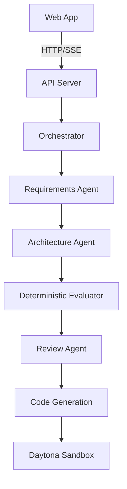

# Multi-Agent AI App Builder & System Design Generator

> Final Year Engineering Project — Multi-Agent AI Platform that transforms natural-language application ideas into executable, validated full-stack applications.

## What It Does

1. Takes a plain-English application description
2. Runs a multi-agent pipeline (Requirements → Architecture → DB/API/Security → Evaluation → Review → Code Generation)
3. Generates a real, runnable React + Node.js + MongoDB project
4. Executes it in a Daytona sandbox
5. Runs automated tests and health checks
6. Debugs and repairs failures automatically
7. Compares Ollama vs OpenAI outputs using 20 deterministic metrics

## Tech Stack

| Layer | Technology |
|---|---|
| Frontend | React + Vite + TypeScript + Tailwind + React Flow |
| Backend | Node.js + Express + TypeScript |
| Database | MongoDB + Mongoose |
| LLM (local) | Ollama |
| LLM (cloud) | OpenAI |
| Sandbox | Daytona |
| Monorepo | npm workspaces |

## Prerequisites

- Node.js 18+
- npm 9+
- MongoDB (local or Atlas) **or** Docker for MongoDB
- Ollama installed (for local LLM)
- OpenAI API key (for cloud LLM)
- Daytona account (for sandbox execution)

## Quick Start

### 1. Clone / Open the repository

```bash
cd "mult-agent app"
```

### 2. Install dependencies

```bash
npm install
```

### 3. Configure environment

```bash
cp .env.example .env
# Edit the root .env file with your values
```

Minimum required `.env`:
```
MONGODB_URL=mongodb://localhost:27017/multiagent
OLLAMA_BASE_URL=http://localhost:11434
OLLAMA_MODEL=qwen2.5:0.5b
PORT=4000
```

For OpenAI comparison:
```
OPENAI_API_KEY=sk-...
OPENAI_MODEL=gpt-4o
```

For Daytona sandbox:
```
DAYTONA_API_KEY=...
DAYTONA_API_URL=https://app.daytona.io/api
```

### 4. Start MongoDB

```bash
# Option A: Docker
docker compose up -d

# Option B: Local MongoDB
mongod --dbpath ./data
```

### 5. Start Ollama

```bash
# Install Ollama from https://ollama.com
ollama pull qwen2.5:0.5b
ollama serve
```

### 6. Start the platform

```bash
# Start both API (port 4000) and Web (port 5173)
npm run dev
```

Or start separately:
```bash
# API server
npm run dev --workspace=backend/api

# Frontend
npm run dev --workspace=frontend/web
```

### 7. Open the dashboard

Visit: **http://localhost:5173**

The repository is organized into two application boundaries:

- `frontend/web` - React/Vite user interface
- `backend/api` - Express API and environment loading
- `backend/packages` - shared backend packages for schemas, agents, LLM providers, orchestration, and evaluation

The API loads the root `.env` file. Restart the backend after changing `OPENAI_API_KEY`.

## Running a Demo

1. Open **http://localhost:5173**
2. Go to **New Project**
3. Select **Ollama** provider
4. Click **"Use: Task Management App"** demo prompt
5. Click **"Create & Run Project"**
6. Watch the agent workflow execute in real time

## LLM Comparison Demo

1. Go to **Experiments**
2. Click **New Experiment**
3. Use the Task Management App prompt
4. Set Ollama model (e.g., `qwen2.5:0.5b`) and OpenAI model (e.g., `gpt-4o`)
5. Click **Start Experiment**
6. Click the experiment → **View Comparison**

Both runs are completely isolated — they never share state.

## Architecture

```
User → Web App → API Server → Orchestrator
                                    ↓
               Requirements Agent → Architecture Agent → DB/API/Security Agents
                                    ↓
               Architecture Evaluator (deterministic, no LLM)
                                    ↓
               Review Agent → [Architecture Revision loop]
                                    ↓
               Code Generation Agents (Backend + Frontend)
                                    ↓
               Daytona Sandbox → Build → Tests → Health Check
                                    ↓
               Debug/Repair Agent → Rebuild → Retest
                                    ↓
               Final Validation → Export
```

## Mermaid Architecture Diagrams

Open a project's **Architecture** view to copy or download the validated architecture as Mermaid `flowchart TD` source. Component types are rendered with stable Mermaid classes, and generic model labels such as `service` are normalized to the canonical `backend` type before the diagram is produced.



## Environment Variables Reference

| Variable | Default | Description |
|---|---|---|
| `OPENAI_API_KEY` | — | OpenAI API key (never exposed to frontend) |
| `OPENAI_MODEL` | `gpt-4o` | OpenAI model name |
| `OLLAMA_BASE_URL` | `http://localhost:11434` | Ollama server URL |
| `OLLAMA_MODEL` | `qwen2.5:0.5b` | Ollama model name |
| `MONGODB_URL` | — | MongoDB connection string |
| `DAYTONA_API_KEY` | — | Daytona API key |
| `DAYTONA_API_URL` | — | Daytona API URL |
| `MAX_AGENT_RETRIES` | `3` | Max retries per agent |
| `MAX_ARCHITECTURE_ITERATIONS` | `3` | Max architecture revision loops |
| `MAX_DEBUG_ITERATIONS` | `5` | Max debug/repair iterations |
| `SANDBOX_TIMEOUT` | `300000` | Sandbox timeout in ms |
| `PORT` | `4000` | API server port |

## Running Tests

```bash
npm test
```

## Type Checking

```bash
npm run typecheck
```

## Known Limitations

1. **Daytona:** Requires a paid Daytona account for sandbox execution. Without it, build/test results are unavailable — the UI clearly indicates this.
2. **Ollama models:** Small models (0.5b) may produce invalid JSON requiring retries. Larger models (7b+) work better.
3. **Code generation:** Generated code may have TypeScript errors for complex applications. The debug agent attempts to repair them.
4. **No embeddings:** The system uses deterministic/keyword matching — no vector DB or embedding model is used.
5. **Single-node:** No horizontal scaling of the API server; designed for demonstration purposes.

## Security

- API keys are server-side only — never exposed to the browser
- Generated code paths are validated (no directory traversal)
- Daytona provides sandbox isolation for generated code
- Logs are sanitized before passing to LLMs
- No secrets in generated application code

## License

MIT — For educational/demonstration purposes.
